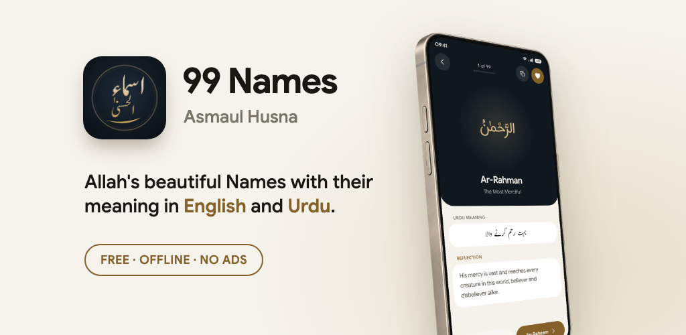
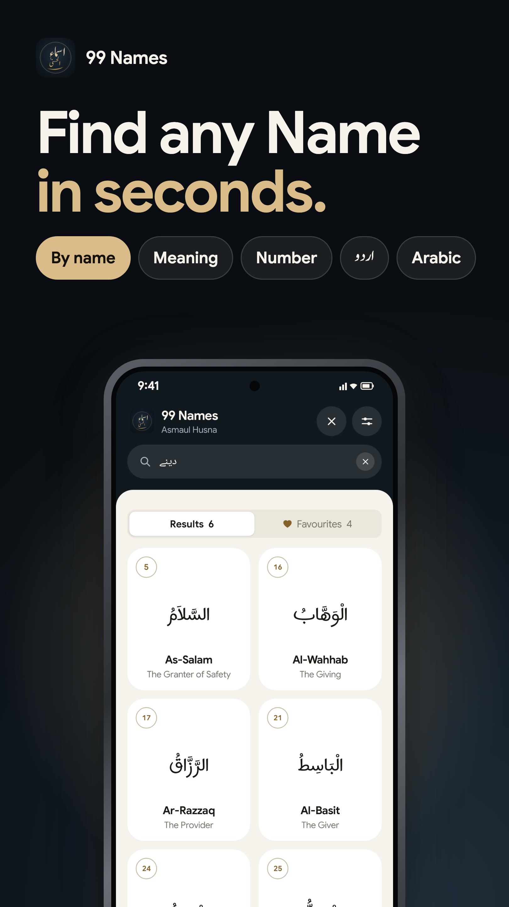
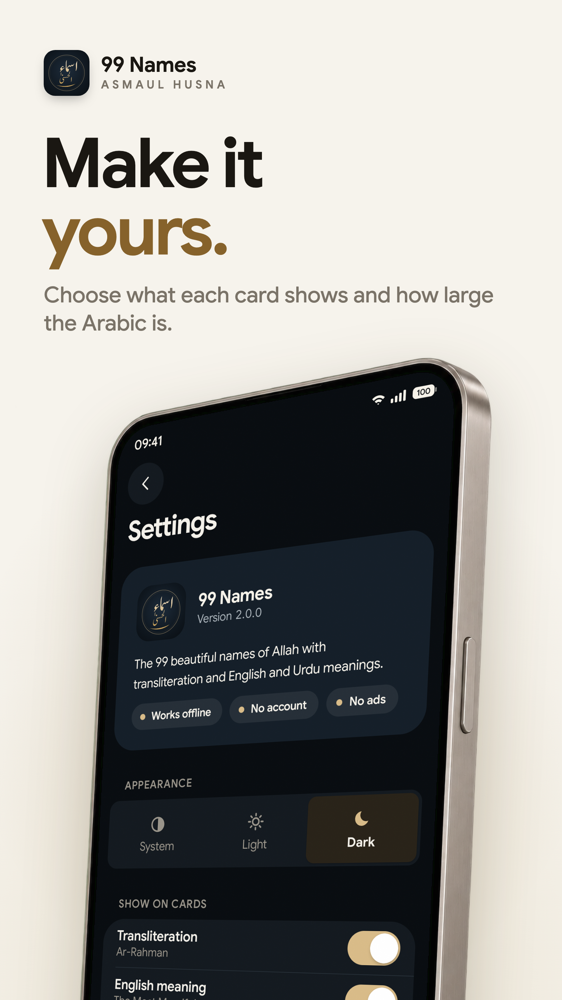

  
  <h1>99 Names - Asmaul Husna</h1>
  
The 99 beautiful names of Allah. Arabic, English and Urdu. Fully offline.

  

The 99 beautiful names of Allah — Arabic, transliteration, English and Urdu
meanings, with a short reflection for each, and a new Name of the day. Works
fully offline: no account, no ads. About 2 MB.

The Arabic and the order come from Jami at-Tirmidhi 3507; the English and Urdu
meanings come from its published translations, not machine translation.

- A native Android app: Kotlin + Jetpack Compose, in [`native/`](native)
- Package: `com.muzamil.asmaulhusna` · version 2.0.0 · Android 7.0+ (minSdk 24)
- Themes: System, Light, Dark (ink blue, ivory + bronze)
- Website: [99.teamsazen.com](https://99.teamsazen.com), in [`website/`](website)

## Screenshots

  
  
  
  
  
  
  
  

## Build

Needs JDK 17+ and the Android SDK (Android Studio has both).

    cd native
    ./gradlew :app:assembleDebug        # debug APK
    ./gradlew testDebugUnitTest         # data tests (exactly 99 Names, in order)
    ./gradlew :app:bundleRelease        # Play Store AAB

Compose without Material: the app draws its own controls. Its only libraries are
AndroidX, Firebase Analytics and Play's in-app updates.

The upload key (`native/key.properties`) and the Firebase config
(`native/app/google-services.json`) are not in this repo. Without them the app
still builds: release builds use the debug key and analytics stays off.

## Where things are

| Path | What |
|---|---|
| `native/app/src/main/java/…/data/Names.kt` | The 99 Names: the one source of truth for the app and the website |
| `native/app/src/main/java/…/screens/` | Home (grid, search, favourites), Name and Settings screens |
| `native/app/src/main/java/…/ui/` | Theme, colours, icons, logo and shared widgets |
| `native/app/src/test/` | Data tests, and `StoreShots.kt` for screenshots |
| `website/` | The website, built from `Names.kt` |
| `store/` | Play Store listing text, images and how they are made |
| `docs/` | Privacy policy and terms |
| `design/brand/` | Wordmark and icon masters |
| `tool/subset_fonts.py` | Trims the fonts to the text the app and site draw |

## Screenshots and store images

The store and website screenshots are the real screens, rendered on the JVM
with [Paparazzi](https://github.com/cashapp/paparazzi) (no emulator needed):

    cd native && ./gradlew :app:recordPaparazziDebug

They land in `native/app/src/test/snapshots/images/`. Copy the ones listed in
`store/listing/index.html` to `store/listing/screens/`, then run
`store/listing/render.sh` (needs Google Chrome) for the eight Play Store images
and the feature graphic. Copy the results to `store/playstore/`. Listing text,
release notes and the Data safety answers are in
[`store/listing.md`](store/listing.md).

## Analytics and privacy

Release builds send anonymous usage events to Firebase Analytics: screens and
Names opened, favourites, and taps on Share or Rate. No account, no name or
email, and the advertising ID is turned off. Debug builds send nothing. See the
[privacy policy](https://99.teamsazen.com/privacy/) (`docs/privacy-policy/`) and
update it whenever what is logged changes.

## Fonts & credits

| Font | Used for | Source | Licence |
|---|---|---|---|
| Harmattan | Arabic | [Google Fonts](https://fonts.google.com/specimen/Harmattan) | SIL OFL 1.1 · SIL International |
| Jameel Noori Nastaleeq | Urdu | [urdufonts.net](https://urdufonts.net/fonts/jameel-noori-nastaleeq-regular) | Free of charge for Urdu lovers |
| Google Sans | Text | [Google Fonts](https://fonts.google.com/specimen/Google+Sans) | SIL OFL 1.1 |

The same credits appear in the app under Settings → Fonts & credits.

The fonts in `native/app/src/main/res/font/` and `website/public/fonts/` are
trimmed to exactly what is drawn (Jameel Noori Nastaleeq goes from 10.5 MB to
73 KB). After changing any text, download the full fonts into `tool/fonts_src/`
(see its README) and run:

    pip install fonttools uharfbuzz brotli
    python3 tool/subset_fonts.py

It lays out every Urdu string with HarfBuzz, keeps only the glyphs used, and
checks the trimmed font lays them out identically. Skipping it shows missing
letters.

## App icon

The icon is the stacked Urdu wordmark **اسماء الحسنیٰ**: outlined Jameel Noori
Nastaleeq lettering in muted bronze on ink blue. The masters and usage notes
are in [`design/brand/`](design/brand).

## Website

`website/` is the landing page, live at https://99.teamsazen.com (Cloudflare
Pages). `node build.mjs`:

- fills `src/index.html` with all 99 Names, read from `Names.kt`, so the site
  never drifts from the app;
- writes one page per Name at `/names/<name>` from `src/name.html` (the two
  Names transliterated Al-Majid get their number in the URL);
- writes `sitemap.xml`, and copies `public/` and the privacy policy and terms
  from `docs/`.

Deploy with `cd website && npm run deploy`. Everything is self-hosted (fonts,
images, Lenis for smooth scrolling); nothing loads from other servers. Arabic
and Urdu use the trimmed fonts, so new Arabic or Urdu text on the site must be
followed by `tool/subset_fonts.py`.

## History

Version 1.0.0 was a Flutter app. 2.0.0 rewrote it natively in Kotlin; it
installs as an update over 1.0.0 and keeps every user's favourites and
settings. The Flutter code is in the git history before that change.

## License & Branding

The source code is licensed under [MIT](LICENSE): use, modify, and share all or part of it, including commercially, while keeping the required copyright and license notices.

The **99 Names name, logos, app icons, and branded artwork are not licensed for reuse as your own app branding**. Published forks should use their own identity unless permission is granted. See the [branding policy](BRANDING.md); third-party content retains its own terms.

99 Names is fully free. To improve the official app under the 99 Names name, contributions here are always welcome.

## Contributing

Contributions are welcome! Open an issue or send a pull request.

## Contributors

<a href="https://github.com/teamsazen"><picture><source media="(prefers-color-scheme: dark)" srcset=".github/readme/contributor-dark.png"></picture></a>
