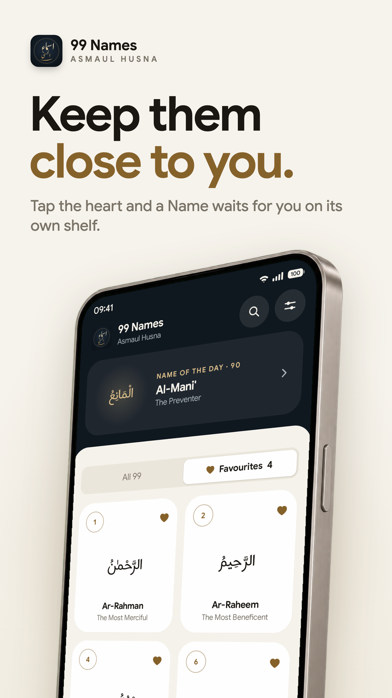
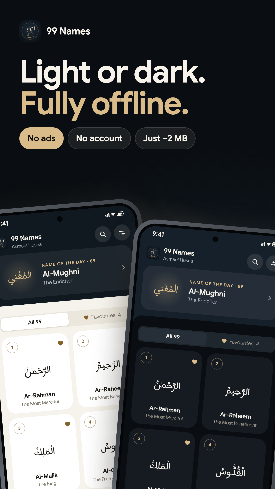

  
  <h1>99 Names - Asmaul Husna</h1>
  
The 99 beautiful names of Allah. Arabic, English and Urdu. Fully offline.

  

The 99 beautiful names of Allah — Arabic, transliteration, English and Urdu
meanings, with a short reflection for each, and a new Name of the day. Works
fully offline: no account, no ads. About 2 MB on Android.

The Arabic and the order come from Jami at-Tirmidhi 3507; the English and Urdu
meanings come from its published translations, not machine translation.

| | Android (Google Play) | iOS |
|---|---|---|
| Code | [`native/`](native): Kotlin + Jetpack Compose | Flutter (`lib/`, `ios/`) |
| Version | 2.0.0 | 1.0.0 |

- Package / bundle ID: `com.muzamil.asmaulhusna`
- Themes: System, Light, Dark (ink blue, ivory + bronze)
- Content: `lib/src/data/names.dart` is the one source of truth; the Android
  app's `Names.kt` is generated from it (see below).
- Analytics: the Android release build sends anonymous usage events to
  Firebase Analytics (see the [privacy policy](https://99.teamsazen.com/privacy/)).
  Debug builds, iOS and builds without a Firebase config send nothing.

## Android app (Kotlin)

Since 2.0.0 the Play Store app is a native Kotlin app in `native/`: Jetpack
Compose, no other UI libraries, minSdk 24, targetSdk 36. It replaced the Flutter
Android build as an update (same package and signing key) and keeps every
user's favourites and settings from the Flutter version.

    cd native
    ./gradlew :app:assembleDebug        # debug APK
    ./gradlew testDebugUnitTest         # data tests (exactly 99 Names, in order)
    ./gradlew :app:bundleRelease        # Play Store AAB

- `python3 tool/native/gen_kotlin.py` regenerates `Names.kt` and the wordmark
  from the Flutter sources. Run it after changing `lib/src/data/names.dart`.
- `python3 tool/native/subset_fonts.py` trims Harmattan (Arabic) to the letters
  the app draws.
- Store and website screenshots are the real screens, rendered on the JVM with
  [Paparazzi](https://github.com/cashapp/paparazzi):
  `./gradlew :app:recordPaparazziDebug` (see `StoreShots.kt`). Copy them to
  `store/listing/screens/` and run `store/listing/render.sh` for the eight Play
  Store images and the feature graphic.

The signing key (`android/key.properties`) and the Firebase config
(`google-services.json`) are not in this repo. Without them the app still
builds: release builds use the debug key and analytics stays off.

## Screenshots

  
  
  
  
  
  
  
  

## Fonts & credits

| Font | Used for | Source | Licence |
|---|---|---|---|
| Jameel Noori Nastaleeq | Urdu | [urdufonts.net](https://urdufonts.net/fonts/jameel-noori-nastaleeq-regular) | Free of charge for Urdu lovers |
| Harmattan | Arabic (Android app, website) | [Google Fonts](https://fonts.google.com/specimen/Harmattan) | SIL OFL 1.1 · SIL International |
| PDMS Saleem Quran | Arabic (Flutter app) | [urdunigaar.com](https://urdunigaar.com/download/pdms-saleem-quran-font-ttf-file-download/) | © 2001 Pakistan Data Management Services |
| Google Sans | Text | [Google Fonts](https://fonts.google.com/specimen/Google+Sans) | SIL OFL 1.1 |

The same credits appear in the app under Settings → Fonts & credits.

`assets/fonts/` holds copies trimmed to exactly what the app draws (about
350 KB in total; Jameel Noori Nastaleeq alone goes from 10.5 MB to 75 KB).
After changing any text in `lib/`, download the full fonts into
`tool/fonts_src/` (see its README) and regenerate:

    pip install fonttools uharfbuzz
    python3 tool/subset_fonts.py

The script lays out every Urdu string with HarfBuzz, keeps only the glyphs
used, and checks the trimmed font lays them out identically.

## App icon

The icon uses the approved stacked Urdu **اسماء الحسنیٰ** wordmark: outlined
Jameel Noori Nastaleeq lettering in muted bronze on ink blue. The same
`AppLogo` widget appears in Settings → About and generates the native icons.
The vector master and usage notes live in [`design/brand/`](design/brand).

To update the vector geometry and regenerate every icon:

    python3 tool/icon/build_wordmark.py
    tool/icon/make_icons.sh

The first command requires `fonttools`; the second requires Flutter and
ImageMagick. Exports include iOS icons, Android legacy/adaptive/themed icons,
the Play Store icon (`store/app_icon.png`), website icons and the README asset.
The Android app in `native/` has its own copies in `native/app/src/main/res/mipmap-*`
(WebP); update them too, then re-render the store screenshots.

## Website

`website/` is the landing page, live at
https://99.teamsazen.com (Cloudflare Pages). `node build.mjs` fills `src/index.html` with all 99 Names read from
`lib/src/data/names.dart`, so the site's Names section never drifts from the
app, writes one page per Name at `/names/<name>` from `src/name.html` (the two
Names transliterated Al-Majid get their number in the URL: `al-majid-48`,
`al-majid-65`) and generates `sitemap.xml` with every page, and copies `public/` (fonts from `assets/fonts/`, screenshots) and the
privacy policy from `docs/privacy-policy/` into `dist/`. The privacy policy URL
for Google Play (and any later store) is https://99.teamsazen.com/privacy;
edit `docs/privacy-policy/index.html` and redeploy to change it. Deploy with
`cd website && npm run deploy`. Arabic and Urdu use the app's trimmed fonts, so
any new Arabic or Urdu text on the site must already exist in the app; Google
Sans is a full copy. The phones and the gallery show the native Android
screens (from Paparazzi, above).

The site uses the Sazen studio layout shared with urduquran.teamsazen.com: a
floating glass header, a hero with a ghost line of Arabic and three phones, a
marquee, a live "Name of the day" card (the same Name the app shows today), a
deep ink card with the app's rosette drawing itself in, the features list, the
99 Names with search, the Play Store gallery, FAQ and a giant footer wordmark.
It wears the app's colours (warm stone by day, deep ink at night, one
bronze-gold accent), and its phones show light or dark captures to match the
visitor's theme. Styles live in `website/public/styles.css` (also used by the
privacy page), motion, the live card and the Names search in
`website/public/site.js`, with Lenis (MIT) in `website/public/js/` and Google
Sans (SIL Open Font License) self-hosted in `website/public/fonts/`. Nothing is
loaded from other servers.

## Release

- Android: `cd native && ./gradlew :app:bundleRelease` (bump `versionCode` and
  `versionName` in `native/app/build.gradle.kts`). Store text and Data safety
  answers are in [`store/listing.md`](store/listing.md).
- iOS: `flutter build ipa --release`.

## License & Branding

The source code is licensed under [MIT](LICENSE): use, modify, and share all or part of it, including commercially, while keeping the required copyright and license notices.

The **99 Names name, logos, app icons, and branded artwork are not licensed for reuse as your own app branding**. Published forks should use their own identity unless permission is granted. See the [branding policy](BRANDING.md); third-party content retains its own terms.

99 Names is fully free. To improve the official app under the 99 Names name, contributions here are always welcome.

## Contributing

Contributions are welcome! Open an issue or send a pull request.

## Contributors

<a href="https://github.com/teamsazen"><picture><source media="(prefers-color-scheme: dark)" srcset=".github/readme/contributor-dark.png"></picture></a>
