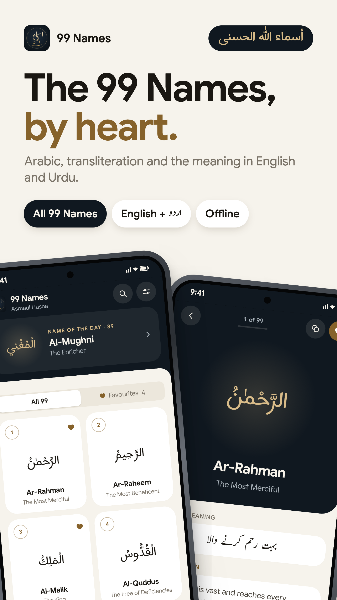
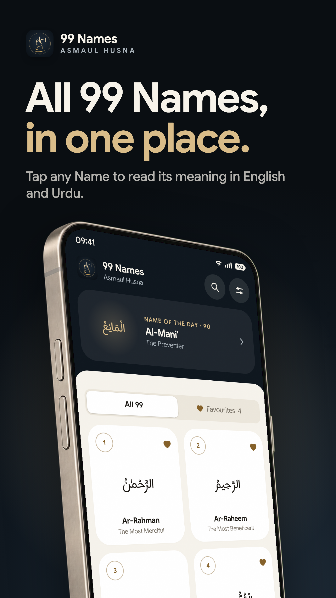
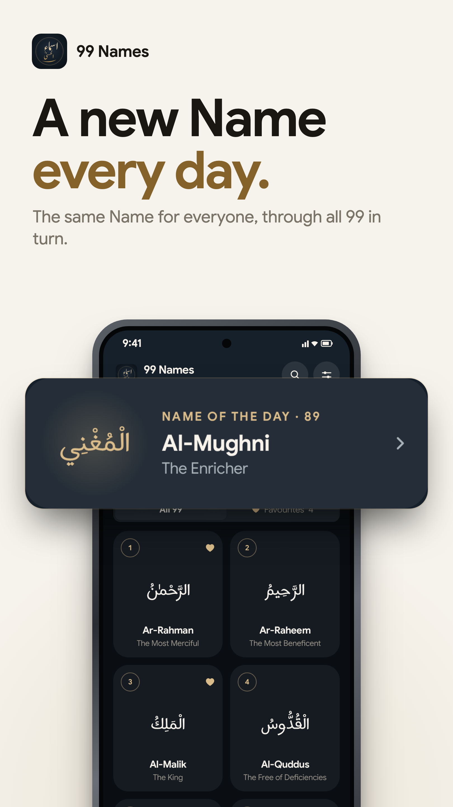

  
  <h1>99 Names - Asmaul Husna</h1>
  
The 99 beautiful names of Allah. Arabic, English and Urdu. Fully offline.

  

The 99 beautiful names of Allah, each in Arabic with its transliteration, its
meaning in English and Urdu, and a short reflection. Works fully offline: no
account, no ads, and only about 2 MB.

## Features

- **Every Name in Arabic**, with transliteration and its meaning in English and
  Urdu (in Nastaleeq)
- **A short reflection** on each Name
- **Name of the day**: the same Name for everyone, through all 99 in turn
- **Search** in English, Urdu or Arabic, or by number
- **Favourites**: tap the heart to keep a Name on its own shelf
- **Make it yours**: choose what each card shows and how large the Arabic is
- **Light, dark or system theme**
- **Fully offline**, no account, no ads, about 2 MB · Android 7.0 and up

## Trusted sources

The Arabic and the order of the Names come from Jami at-Tirmidhi 3507. The
English and Urdu meanings come from its published translations, not machine
translation.

## Screenshots

  
  
  
  
  
  
  
  

## Website

Every Name has its own page on [99.teamsazen.com](https://99.teamsazen.com).

## Privacy

No account, and no name, email or other personal information is asked for. On
Android the app sends anonymous usage statistics to Firebase Analytics, for
example which screens are opened. See the
[privacy policy](https://99.teamsazen.com/privacy/).

## Fonts & credits

| Font | Used for | Source | Licence |
|---|---|---|---|
| Harmattan | Arabic | [Google Fonts](https://fonts.google.com/specimen/Harmattan) | SIL OFL 1.1 · SIL International |
| Jameel Noori Nastaleeq | Urdu | [urdufonts.net](https://urdufonts.net/fonts/jameel-noori-nastaleeq-regular) | Free of charge for Urdu lovers |
| Google Sans | Text | [Google Fonts](https://fonts.google.com/specimen/Google+Sans) | SIL OFL 1.1 |

The same credits appear in the app under Settings → Fonts & credits.

## License & Branding

The source code is licensed under [MIT](LICENSE): use, modify, and share all or part of it, including commercially, while keeping the required copyright and license notices.

The **99 Names name, logos, app icons, and branded artwork are not licensed for reuse as your own app branding**. Published forks should use their own identity unless permission is granted. See the [branding policy](BRANDING.md); third-party content retains its own terms.

99 Names is fully free. To improve the official app under the 99 Names name, contributions here are always welcome.

## Contributing

Contributions that make the app better are welcome: a correction with a reliable
source, better data, or a tested fix. Please read [CONTRIBUTING.md](CONTRIBUTING.md)
first; it explains what to send and what to write in your pull request.
